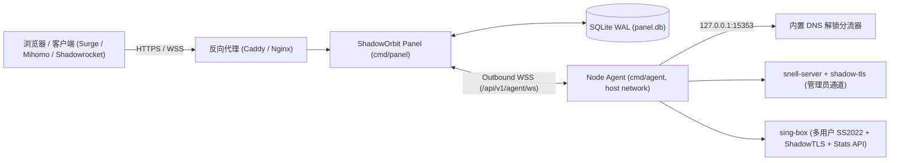

# ShadowOrbit — 多节点代理控制面与订阅管理系统

**ShadowOrbit** 是一款轻量级、生产就绪的多节点代理管理面板，专为 **Snell + ShadowTLS v3**（管理员专用通道）与 **Shadowsocks 2022 (EIH) + ShadowTLS v3**（多用户通道）双轨架构设计。服务端采用 Go + SQLite（WAL 模式）+ 内嵌 React/TypeScript Web UI 构建，节点端与管理端均提供 `linux/amd64` 与 `linux/arm64` 双架构 Docker 镜像。

---

## 核心特性

### 1. 三内核物理隔离与低中断变更
- **管理员通道（`snell-server` + `shadow-tls`）**：`snell-server`（支持 v4/v5）仅监听 `127.0.0.1:<snell_inner_port>`，由官方 `shadow-tls` v3（`--v3 --strict --fastopen`）对外提供入口，避免直接暴露代理协议特征。
- **用户通道（`sing-box`）**：单进程内封装 `stls-in`（ShadowTLS v3 strict 模式）、`ss-tcp-in`（支持 `2022-blake3-aes-128-gcm` / `2022-blake3-aes-256-gcm` EIH 多用户鉴权与 UDP-over-TCP）、`ss-udp-in` 原生 UDP 及 `v2ray_api` 实时流量统计端口。
- **变更隔离**：新增、禁用或调整普通用户配额时**仅热重载 `sing-box`**，管理员的 `snell-server` + `shadow-tls` 连接保持不断。
- **离线自治**：节点端将下发配置持久化至 `last_config.json`，管理端短暂失联或重启期间节点照常转发代理流量。

### 2. 免登录脱敏公开状态页与全端响应式适配
- **编译期脱敏（`PublicNodeView`）**：`/` 与 `/api/v1/public/status`、`/api/v1/public/ws` 严格裁剪输出字段，绝不暴露节点 IP、端口、PSK、ShadowTLS 密码、解锁 DNS 或用户列表；支持展示实时在线状态、延迟与节点累计已上传/已下载流量。
- **移动端适配**：公开状态页与管理后台（`/admin/*`）针对手机与桌面端做了完整响应式布局与侧滑抽屉导航，小屏下自动切换卡片视图。

### 3. 双轨订阅与 CDN 加速机场规则模板
- **管理员专属 Surge 订阅（`GET /s/admin/<admin_sub_token>`）**：仅输出已启用的 `Snell + ShadowTLS v3` 节点；支持在「用户与订阅管理」页通过弹窗可视化配置、一键预览输出并再次点击收起预览。`threshold_action=stop_ss_only` 时保留管理员通道不断线。
- **多用户 SS2022 订阅（`GET /s/u/<user_sub_token>`）**：自动依据节点加密套件匹配对应 16/32 字节 Base64 `uPSK`，支持 `?target=mihomo|surge|shadowrocket&mode=full|proxy&tpl=<id>`，缺省时按 `User-Agent` 自动识别客户端，并输出标准 `Subscription-Userinfo` 与 `Profile-Update-Interval` 响应头。
- **CDN 规则集与 Surge 规则兼容**：内置机场常用分流规则模板（AI 服务、国际媒体、TikTok、Spotify、Telegram、Apple、Google、广告拦截等），默认采用 `fastly.jsdelivr.net/gh/blackmatrix7/ios_rule_script@master/` 镜像加速规则集拉取，避免国内首次导入超时，且不包含 Surge 禁止声明的内置策略名冲突项。

### 4. 内置 DNS 解锁分流器
- 节点端内置基于 `miekg/dns` 的本地 UDP+TCP 分流 DNS（默认绑定 `127.0.0.1:15353`），同时服务 `snell-server` 与 `sing-box`。
- 兼容 `MoeClub/haproxy_docker` 域名规则语法（`#` / `//` 注释、`abc.com`、`^abc.com` / `@abc.com`、`*.abc.com`），解锁 DNS 支持自定义 `IP:Port`（如 `1.2.3.4:3535`）。
- 针对命中解锁规则的域名，自动对 `AAAA` / `HTTPS` / `SVCB` / `ANY` 返回空 `NODATA` 响应，防止 IPv6 与 ECH 直连绕过。规则组配置已集成至「系统设置」页。

### 5. 精细化流量统计、日志上限与自动清零
- **节点物理流量**：节点端每 5 秒采集宿主网卡 `/proc/net/dev`（支持 `IFACE` 手动指定及重启计数器回绕保护）。
- **多用户与管理员渠道流量**：每 10 秒通过 `sing-box` gRPC `StatsService/QueryStats` 采集用户明细流量，并通过 `/proc/<pid>/io` 采集管理员 `snell-server` 渠道流量；断连期间缓存至本地 WAL（`pending_traffic.json`）并在重连后补报。
- **节点 × 用户联动看板与分钟级明细**：支持点击任意用户或管理员已用流量查看按节点降序分布明细；流量日志按分钟粒度记录节点与用户对应消耗，并支持在设置或流量页配置日志保存上限（默认 `10000` 条）。
- **计费统计与周期重置**：支持 `both`、`tx_only`、`rx_only`、`max_dir` 四种计数方式与 `stop_all` / `stop_ss_only` 超限策略；支持按月设置结算日（`1..31`，自动适配 2 月等短月）并在本地 `00:00` 自动清零恢复。

### 6. 通知告警、内核中心与镜像自定义
- **多渠道 Webhook（集成于「系统设置」页）**：支持飞书（交互卡片 + 签名）、钉钉（Markdown + 加签）、企业微信（Markdown）、**Server酱**及自定义 JSON/模板 Webhook，支持冷却时间控制、节点上线/流量恢复通知及一键测试推送。
- **内核版本管理与自愈热更新**：支持同步 `sing-box`、`shadow-tls` GitHub Releases 与管理自定义 `snell-server` 下载源；下发升级时自动校验可选 SHA-256、自检版本输出、备份 `.bak`，端口健康检查失败 3 秒内自动回滚。
- **节点 Docker 镜像可配置**：支持在「系统设置」页配置 `agent_docker_image`（默认 `saitomikuya/shadoworbit-agent:latest`），自动同步至节点一键安装命令生成器。

---

## 系统架构



---

## 快速部署

### 一、部署管理端（Panel Server）

推荐使用官方 Docker 镜像 `saitomikuya/shadoworbit:latest`（或直接使用仓库内的 [deploy/docker-compose.yml](deploy/docker-compose.yml)）：

```yaml
services:
  snell-panel:
    image: saitomikuya/shadoworbit:latest
    container_name: shadoworbit
    restart: always
    ports:
      - "127.0.0.1:8080:8080"
    volumes:
      - ./data:/app/data
    environment:
      - TZ=Asia/Shanghai
      - ADMIN_USER=admin
      - ADMIN_INITIAL_PASS=change_me_on_first_login
      # 可选配置：
      # - LISTEN_ADDR=:8080
      # - DB_PATH=/app/data/panel.db
      # - JWT_SECRET=replace_with_32_byte_or_longer_random_secret
      # - GITHUB_API_URL=https://api.github.com
      # - WEBHOOK_BLOCK_PRIVATE_IPS=false
    healthcheck:
      test: ["CMD", "wget", "-qO-", "http://127.0.0.1:8080/healthz"]
      interval: 30s
      timeout: 5s
      retries: 3
      start_period: 10s
```

在包含 `docker-compose.yml` 的目录执行启动：

```bash
mkdir -p shadoworbit && cd shadoworbit
# 放入上方 docker-compose.yml 后启动
docker compose up -d
```

> 说明：`./data:/app/data` 相对于 `docker-compose.yml` 所在目录挂载；如在仓库根目录执行 `docker compose -f deploy/docker-compose.yml up -d`，数据将存放在 `./deploy/data`。

#### 管理端环境变量与 CLI 参数

| 环境变量 | CLI 参数 | 默认值 | 说明 |
| :--- | :--- | :--- | :--- |
| `LISTEN_ADDR` | `-listen` | `:8080` | HTTP / WebSocket 监听地址（优先于 `PORT`） |
| `PORT` | — | `—` | 当 `LISTEN_ADDR` 为空时的兜底端口（自动规范为 `:<PORT>`） |
| `DB_PATH` | `-db` | `./data/panel.db` | SQLite 数据库文件路径（Docker 内为 `/app/data/panel.db`） |
| `ADMIN_USER` | `-admin-user` | `admin` | 首次启动初始化的管理员用户名 |
| `ADMIN_INITIAL_PASS` | `-admin-pass` | `admin123` | 当数据库尚未设置密码哈希时使用的初始管理员密码 |
| `JWT_SECRET` | `-jwt-secret` | 自动生成 | 可选 JWT 签名密钥（至少 32 字节原始/Base64/Hex）；缺省则自动生成并持久化到 SQLite |
| `GITHUB_API_URL` | `-github-api-url` | `https://api.github.com` | 可选 GitHub Releases API 代理/镜像根地址 |
| `WEBHOOK_BLOCK_PRIVATE_IPS` | `-webhook-block-private-ips` | `false` | 是否禁止 Webhook 请求访问私网或回环 IP |
| `TZ` | — | 系统 / `UTC` | 每日定时任务与 `00:00` 账单清零参考时区 |

补充参数：`-version` 输出 `snell-panel version=... commit=... date=...` 后退出；健康检查接口 `GET /healthz`（支持 `HEAD`）返回 `200 OK` 与 `{"status":"ok"}`。

#### 配置 HTTPS 反向代理（Caddy / Nginx）

建议在 `127.0.0.1:8080` 前置 Caddy 或 Nginx 终结 TLS，并正确转发 `Host`、`X-Forwarded-Proto` 与 WebSocket 升级头（`/api/v1/agent/ws` 与 `/api/v1/public/ws`），以确保生成的 `#!MANAGED-CONFIG` 订阅链接和安装命令与您的公网域名保持一致。

**Caddy 示例：**

```caddyfile
panel.example.com {
    reverse_proxy 127.0.0.1:8080
}
```

**Nginx 示例：**

```nginx
server {
    listen 443 ssl http2;
    server_name panel.example.com;

    # 请配置域名对应的 ssl_certificate 与 ssl_certificate_key

    location / {
        proxy_pass http://127.0.0.1:8080;
        proxy_http_version 1.1;
        proxy_set_header Host $host;
        proxy_set_header X-Real-IP $remote_addr;
        proxy_set_header X-Forwarded-For $proxy_add_x_forwarded_for;
        proxy_set_header X-Forwarded-Proto $scheme;
        proxy_set_header Upgrade $http_upgrade;
        proxy_set_header Connection "upgrade";
        proxy_read_timeout 3600s;
        proxy_send_timeout 3600s;
    }
}
```

---

### 二、部署节点端（Node Agent）

节点端需使用 `--network host`（`network_mode: host`），以便动态接管配置的监听端口并准确读取宿主机 `/proc/net/dev` 网卡计数器；持久化目录 `/var/lib/snell-panel-agent` 用于保存离线配置与流量 WAL。

在管理端「节点管理」创建节点后，可直接复制页面生成的安装命令；也可手动通过以下命令部署（使用官方多架构镜像 `saitomikuya/shadoworbit-agent:latest`）：

**Docker Run：**

```bash
docker run -d \
  --name shadoworbit-agent \
  --restart always \
  --network host \
  -v /opt/shadoworbit-agent:/var/lib/snell-panel-agent \
  -e PANEL_URL="wss://panel.example.com" \
  -e NODE_TOKEN="nd_live_xxxxxxxxxxxx" \
  -e TZ="Asia/Shanghai" \
  saitomikuya/shadoworbit-agent:latest
```

**Docker Compose（节点端）：**

```yaml
services:
  shadoworbit-agent:
    image: saitomikuya/shadoworbit-agent:latest
    container_name: shadoworbit-agent
    restart: always
    network_mode: host
    volumes:
      - /opt/shadoworbit-agent:/var/lib/snell-panel-agent
    environment:
      - PANEL_URL=wss://panel.example.com
      - NODE_TOKEN=nd_live_xxxxxxxxxxxx
      - TZ=Asia/Shanghai
```

#### 节点端环境变量与 CLI 参数

| 环境变量 | CLI 参数 | 默认值 | 说明 |
| :--- | :--- | :--- | :--- |
| `PANEL_URL` | `-panel-url` | 必填 | 管理端地址（支持 `ws://` / `wss://` / `http://` / `https://`，自动拼接 `/api/v1/agent/ws`） |
| `NODE_TOKEN` | `-token` | 必填 | 节点连接令牌（`nd_live_...`） |
| `DATA_DIR` | `-data-dir` | `/var/lib/snell-panel-agent` | 状态与内核配置持久化目录（含 `last_config.json`、`pending_traffic.json` 等） |
| `IFACE` | `-iface` | 自动探测默认路由网卡 | 手动指定 `/proc/net/dev` 流量统计网卡名 |
| `SNELL_BIN` | `-snell-bin` | `snell-server` | `snell-server` 可执行文件路径或命令名 |
| `SHADOW_TLS_BIN` | `-shadow-tls-bin` | `shadow-tls` | `shadow-tls` 可执行文件路径或命令名 |
| `SING_BOX_BIN` | `-sing-box-bin` | `sing-box` | `sing-box` 可执行文件路径或命令名 |
| `LOCAL_DNS_PORT` | `-local-dns-port` | `1053` | 首次连上管理端前的回环 DNS 监听端口（连上后跟随下发配置，面板默认 `15353`） |
| `STATS_PORT` | `-stats-port` | `10085` | `sing-box` 本地 gRPC Stats API 端口（`127.0.0.1:<port>`） |
| `TLS_SKIP_VERIFY` | `-tls-skip-verify` | `false` | 连接 `wss://` 管理端时是否跳过 TLS 证书校验 |
| `PROC_NET_DEV_PATH` | — | `/proc/net/dev` | 覆盖 procfs 网卡计数器文件路径（便于容器/测试环境适配） |
| `PROC_NET_ROUTE_PATH` | — | `/proc/net/route` | 覆盖 procfs 路由表文件路径 |

---

## 日常使用指南

1. **首次登录与系统初始化**：
   - 访问 `/admin` 登录，建议第一时间通过右上角修改密码入口更新管理员密码。
   - 前往「系统设置」检查站点标题、**节点端 Docker 镜像（`agent_docker_image`）**、**流量日志保存上限（默认 `10000` 条）**、DNS 解锁规则组及 Webhook（支持 Server酱等）配置。
2. **添加与管理节点**：
   - 在「节点管理」点击添加节点，填写节点名称、Region 标签（支持按标签快速筛选）、端口与 ShadowTLS SNI 伪装域名等，系统自动支持双栈 IPv4 / IPv6 上报与显示。
   - 点击节点「安装命令」复制一键部署命令并在 VPS 上运行；节点上线后，可在「总览」页实时查看配置同步状态及累计下载/上传流量。
3. **用户授权与双轨订阅**：
   - 在「用户与订阅管理」顶部固定卡片/行中管理管理员自身的 Snell 订阅配置、折叠预览与流量分布；下方列表创建普通用户并勾选允许访问的节点。
   - 点击用户行或管理员行中的已用流量，可弹窗查看按流量从高到低排序的各节点分摊详情。
4. **流量明细与排障**：
   - 在「流量统计」页按节点筛选，直接在同一行查看分钟级时间点、节点名、对应用户（含管理员 Snell 渠道）及上下行字节数。
5. **内核版本升级**：
   - 在「内核中心」同步上游发布版本号或录入自定义 `snell-server` 下载地址，选择目标节点一键热升级并支持失败自动回滚。

---

## 数据备份与恢复

面板数据库采用 SQLite `WAL` 模式（`panel.db`、`panel.db-wal`、`panel.db-shm`），默认挂载于运行目录 `./data`。

**在线热备份（推荐已安装 `sqlite3` 时使用）：**

```bash
sqlite3 ./data/panel.db ".backup ./panel-backup-$(date +%Y%m%d).db"
```

**停机冷备份：**

```bash
docker compose stop
cp -a ./data ./data-backup-$(date +%Y%m%d)
docker compose start
```

恢复数据时请先执行 `docker compose stop`，替换 `./data/panel.db` 并删除旧快照残留的 `./data/panel.db-wal` 与 `./data/panel.db-shm`，再执行 `docker compose start`。

---

## 本地构建与测试

由于 `cmd/panel` 通过 `web/embed.go`（`//go:embed all:dist`）内嵌前端构建产物，执行 Go 测试或编译前需先构建 `web/dist`：

```bash
# 1. 构建内嵌 React + TypeScript 前端
cd web && npm ci && npm run build && cd ..

# 2. 运行静态检查、单元/集成测试与端到端测试
go vet ./...
go test -race ./...
go test -tags e2e -race -timeout 15m ./tests/e2e/...

# 3. 本地交叉/静态编译二进制
CGO_ENABLED=0 go build -trimpath -o shadoworbit-panel ./cmd/panel
CGO_ENABLED=0 go build -trimpath -o shadoworbit-agent ./cmd/agent

# 4. 构建多架构容器镜像
docker buildx build --platform linux/amd64,linux/arm64 -f deploy/Dockerfile.panel -t saitomikuya/shadoworbit:latest .
docker buildx build --platform linux/amd64,linux/arm64 -f deploy/Dockerfile.agent -t saitomikuya/shadoworbit-agent:latest .
```

---

## 开源协议

本项目基于 [MIT License](LICENSE) 开源。
